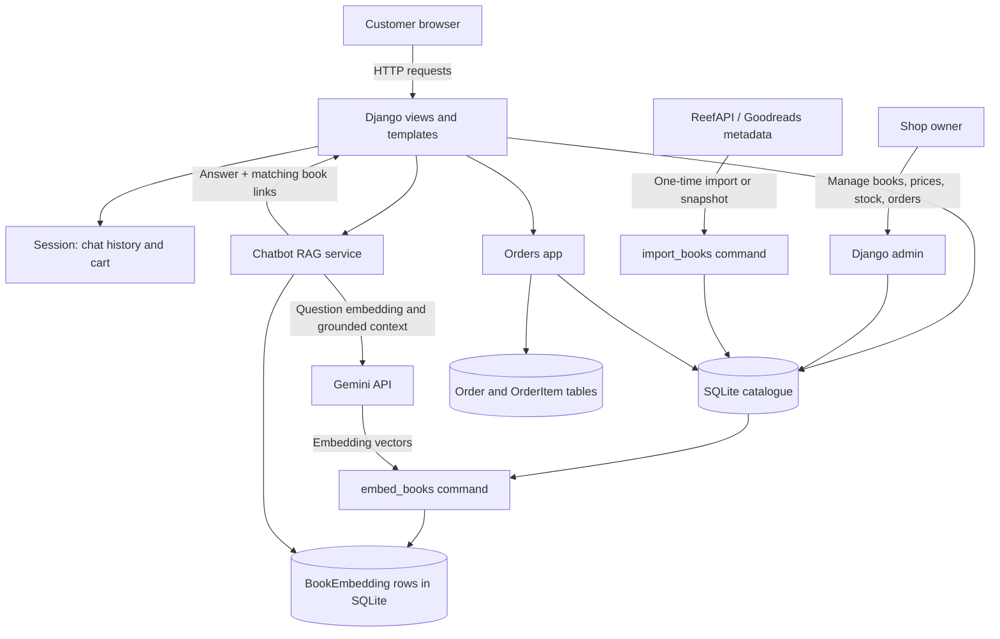

# Architecture

## 1. System context and data flow



## 2. RAG sequence for one chatbot message

```mermaid
sequenceDiagram
    actor Customer
    participant Browser
    participant View as Django chat view
    participant RAG as Chatbot service
    participant DB as SQLite
    participant Gemini
    Customer->>Browser: Ask a book question
    Browser->>View: POST /chat/ with CSRF token
    View->>View: Validate input and session rate limit
    View->>RAG: Message + recent history
    RAG->>Gemini: Embed question (RETRIEVAL_QUERY)
    Gemini-->>RAG: Query vector
    RAG->>DB: Read active book embeddings
    DB-->>RAG: Candidate vectors and books
    RAG->>RAG: Rank by cosine similarity; keep top 5
    RAG->>DB: Read current price and stock
    DB-->>RAG: Live shop values
    RAG->>Gemini: Question, history and grounded catalogue context
    Gemini-->>RAG: Natural-language answer
    RAG->>RAG: Clean currency formatting and match book titles
    RAG-->>View: Reply and book links
    View-->>Browser: JSON response
    Browser-->>Customer: Display answer and book chips
```

## 3. Entity-relationship diagram

```mermaid
erDiagram
    CATEGORY ||--o{ BOOK : classifies
    BOOK ||--o| BOOK_EMBEDDING : has_vector
    USER ||--o{ ORDER : places
    ORDER ||--|{ ORDER_ITEM : contains
    BOOK o|--o{ ORDER_ITEM : references

    CATEGORY {
      bigint id PK
      string name
      string slug UK
    }
    BOOK {
      bigint id PK
      string goodreads_id UK
      string title
      string author
      text description
      decimal price
      int stock
      boolean is_active
      bigint category_id FK
    }
    BOOK_EMBEDDING {
      bigint id PK
      bigint book_id FK UK
      json vector
      string model_name
      string text_hash
    }
    USER {
      bigint id PK
      string username
    }
    ORDER {
      bigint id PK
      bigint user_id FK
      string status
      decimal total
      string payment_method
    }
    ORDER_ITEM {
      bigint id PK
      bigint order_id FK
      bigint book_id FK
      string title
      decimal unit_price
      int quantity
    }
```

The cart and chat history are session data, not database tables. `OrderItem.title` and `OrderItem.unit_price` are snapshots, so old orders remain accurate if a book changes later.
